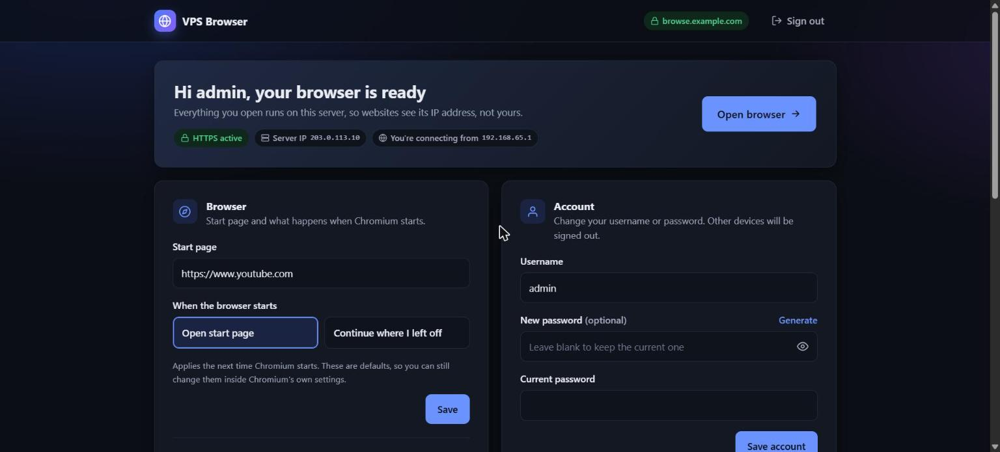
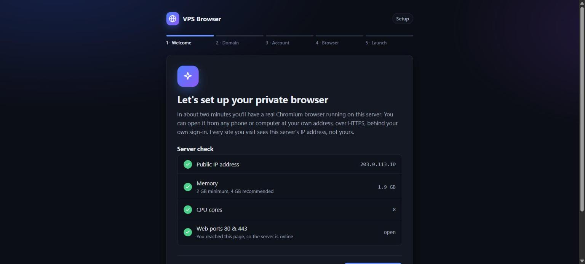
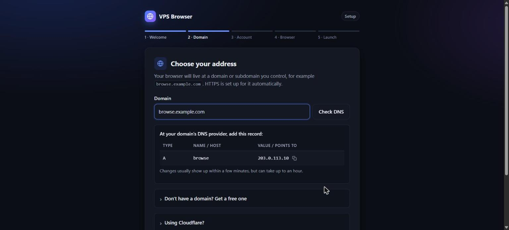
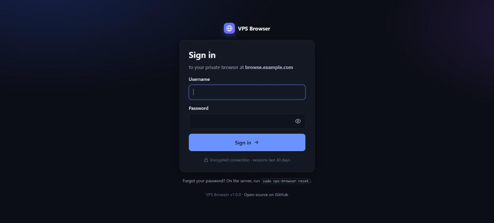

# VPS Browser

**Your own private web browser, running on your own server.** Open your domain from any phone or computer, sign in, and use a real Chromium browser that runs on your VPS. Every website sees your **server's IP address and connection**, not yours. That makes sites that are blocked, throttled or region-locked where you are work normally. There's no VPN app and nothing to install on your devices.

```
your phone / PC ──HTTPS + sign-in──▶ your VPS ──▶ Chromium ──▶ the internet (from the server's IP)
```



## Features

- **One-command install** on any Ubuntu/Debian VPS. Docker and HTTPS are set up for you.
- **Web setup wizard.** It checks your server, tests your domain's DNS live, and walks you through creating your sign-in and choosing a start page. You never edit a config file.
- **Your own domain with automatic HTTPS** (Let's Encrypt). No domain? The wizard shows how to get a free one from DuckDNS.
- **Proper sign-in page** with brute-force lockout, 30-day sessions and "sign out everywhere".
- **Dashboard** to change the domain, username, password and start page, restart a frozen browser, and see recent sign-ins.
- **Real Chromium** with sound, clipboard, and a persistent profile: bookmarks and logged-in sites survive restarts.
- **Secure by design.** The browser is never exposed directly, the panel has no Docker access, and the browser can't reach the panel.
- **Free and open source** (MIT).

## Requirements

- A VPS running **Ubuntu 22.04+ or Debian 12+** (other Linux distros with Docker should work too), with **2 GB RAM minimum** (4 GB recommended) and root/sudo access.
- **Ports 80 and 443 open**. Check your provider's firewall or security group.
- A **domain or subdomain** you can add a DNS record to, or a free one from [DuckDNS](https://www.duckdns.org).

## Install

SSH into your server and run:

```bash
curl -fsSL https://raw.githubusercontent.com/raff4y/vps-browser/main/install.sh | sudo bash
```

When it finishes, it prints a private setup link like:

```
http://203.0.113.10/_vb/setup?token=...
```

Open it in your browser and follow the wizard:

1. **Welcome:** checks the server (IP, memory, CPU).
2. **Domain:** enter e.g. `browse.example.com`, add the A record it shows at your DNS provider, and click **Check DNS**.
3. **Account:** choose a username and a strong password (or generate one).
4. **Browser:** pick a start page.
5. **Launch:** your HTTPS certificate is issued automatically, usually in under a minute. Click **Open my browser**.

| Setup wizard | Domain + live DNS check | Sign-in |
|---|---|---|
|  |  |  |

From then on, go to `https://your-domain` and sign in. The dashboard is at `https://your-domain/_vb/`.

> **Keep the setup link private** until you've finished. Anyone with it could set up the server. It stops working once setup is done.

### Deploy with Coolify

If your server runs [Coolify](https://coolify.io), its proxy already owns ports 80/443 and handles HTTPS, so use the Coolify compose file instead of `install.sh`:

1. Create a **Docker Compose** application from this repo and set **Docker Compose Location** to `/docker-compose.coolify.yml`.
2. Give the **`caddy`** service your domain (e.g. `https://browse.example.com`). Leave `panel` and `browser` **without** a domain, otherwise the sign-in is skipped.
3. Deploy. Optionally set a `TZ` environment variable (e.g. `Asia/Karachi`).
4. Open the **panel** service's logs in Coolify and find the line `Open the setup page: https://YOUR-DOMAIN/_vb/setup?token=…`. Open that link with your domain in place of `YOUR-DOMAIN`. The wizard skips the domain step, since Coolify manages it.

Forgot your password on Coolify? On the server, run `docker exec $(docker ps -qf name=panel) /panel reset`, then look in the panel logs for the new setup link.

## Managing your server

The installer adds a `vps-browser` command:

| Command | What it does |
|---|---|
| `vps-browser status` | Show what's running |
| `vps-browser logs` | Follow the logs (`logs browser`, `logs caddy`, `logs panel`) |
| `vps-browser update` | Update to the latest version |
| `vps-browser restart` | Restart everything |
| `vps-browser reset` | **Forgot your password?** Re-opens setup and prints a new setup link. Your bookmarks and logins are kept. |
| `vps-browser setup-url` | Show the setup link again |
| `vps-browser backup` / `restore <file>` | Save or restore the browser profile and settings |
| `vps-browser uninstall` | Remove everything, including all data |

Most day-to-day changes (domain, password, start page, restarting the browser) are done from the dashboard.

## Troubleshooting

| Problem | Fix |
|---|---|
| Setup link doesn't load | Make sure port 80 is open in your provider's firewall. Run `vps-browser status`. |
| "Waiting for HTTPS certificate" never finishes | The domain's A record must point to the server, ports 80 **and** 443 must be open, and Cloudflare must be set to **DNS only** (grey cloud). See `vps-browser logs caddy`. |
| Lost the setup link | `sudo vps-browser setup-url` |
| Forgot password | `sudo vps-browser reset` |
| Black screen or frozen browser | Dashboard, then **Restart browser**. If it keeps happening, the server needs more RAM. |
| Video is choppy | Open the sidebar inside the browser page and lower the quality or resolution. |
| Ports 80/443 already in use | Another web server (nginx, apache) is running. Stop it, or run vps-browser on a separate VPS. |

## How it works

Three containers, managed by Docker Compose:

| Service | Role |
|---|---|
| **caddy** | The only thing exposed to the internet. Provides HTTPS (on-demand certificates, only for your configured domain) and checks every browser request with the panel. |
| **panel** | A small Go service: the setup wizard, sign-in page, dashboard and the auth check. It has no Docker access. |
| **browser** | [linuxserver/chromium](https://docs.linuxserver.io/images/docker-chromium/): Chromium on a virtual desktop, streamed to your page. It has no published ports, so it can only be reached through Caddy after sign-in. |

With Coolify (`docker-compose.coolify.yml`), Coolify's proxy does HTTPS and Caddy runs plain HTTP behind it (`coolify/Caddyfile`, with the panel in `TLS_MODE=proxy`).

See [HANDOVER.md](HANDOVER.md) for the architecture in detail, design decisions, local development and the roadmap.

## Security notes

- Anyone who signs in gets full control of a browser that holds your logged-in sessions. **Use a strong, unique password.**
- After 5 wrong passwords, an IP address is locked out for a minute, and the lock doubles with each further miss (up to an hour).
- Your browser profile lives in the Docker volume `vps-browser-data` on your server. Backups made with `vps-browser backup` contain your sessions, so keep them private.
- Using proxies to reach blocked content may be restricted where you live. Check your local laws.

## Development

```bash
git clone https://github.com/raff4y/vps-browser.git && cd vps-browser
TLS_MODE=internal docker compose up -d --build
docker compose exec panel /panel setup-url   # then open http://localhost/_vb/setup?token=...
```

Use `localhost` as the domain in the wizard. `TLS_MODE=internal` uses self-signed certificates, so expect a certificate warning at `https://localhost`. The panel is in [`panel/`](panel) (Go standard library + bcrypt, with HTML/CSS/JS embedded and no build step).

Contributions are welcome. Please open an issue or pull request.

## License

[MIT](LICENSE)
